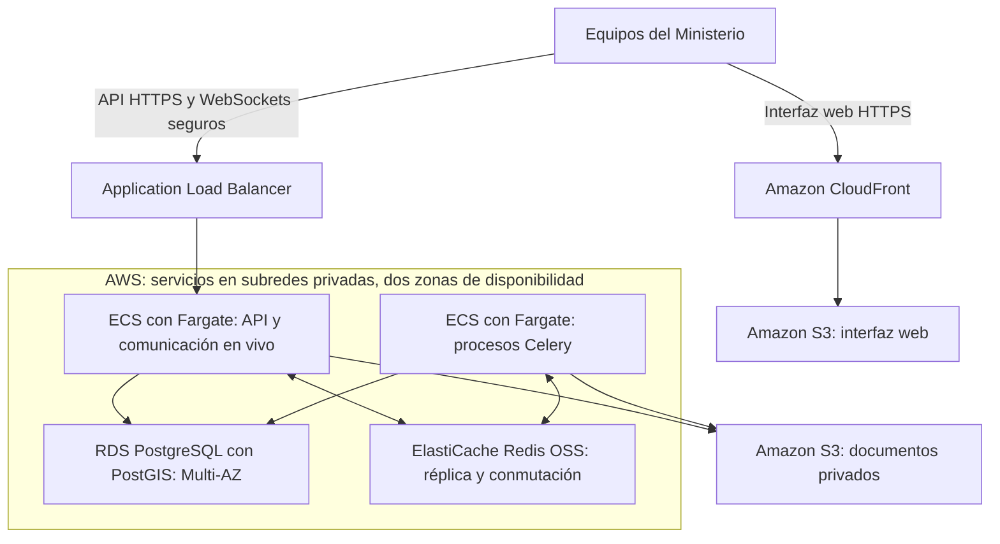

# :material-map-marker-radius-outline: Mesa de Situación del Fenómeno El Niño

## Propuesta de implementación y operación para la Provincia del Chaco

| Campo | Detalle |
|---|---|
| Organismo destinatario | Ministerio de Desarrollo Humano de la Provincia del Chaco |
| Proponente | ICORE |
| Fecha | 14 de octubre de 2026 |
| Versión | 0.3 |
| Estado | Borrador de propuesta para revisión |
| Modalidad | Desarrollo, infraestructura administrada y atención funcional y técnica dedicada 24/7 |
| Plataforma de infraestructura propuesta | Amazon Web Services (AWS), con implementación y operación a cargo de ICORE, partner de AWS |
| Horizonte inicial propuesto | 24 semanas de implementación, con entregas parciales |
| Contenido | Alcance, tecnologías, equipo, dedicación y condiciones del servicio, sin importes |

!!! abstract "La propuesta"
    ICORE propone desarrollar y operar sobre Amazon Web Services (AWS) una plataforma provincial para monitorear la criticidad territorial y coordinar la respuesta social ante el fenómeno El Niño. El servicio reúne información de población afectada, albergues, incidentes, necesidades y asistencia, con un mapa central y actualización en vivo.

!!! info "Alcance de este documento"
    Se trata de un proyecto independiente de Datañach. La experiencia de ese proyecto se toma como referencia de trabajo. Las tecnologías, las dedicaciones, el cronograma y los niveles de servicio de este documento son propuestas a confirmar antes de la contratación.

## 1. Objetivo y resultados esperados

La plataforma permitirá al Ministerio conocer dónde se concentra la demanda, qué población necesita atención, qué capacidad tienen los albergues y cómo avanzan las solicitudes de asistencia.

Cada equipo podrá registrar sus intervenciones y consultar información según su responsabilidad y territorio. La conducción dispondrá de una vista provincial para priorizar acciones y coordinar recursos.

El sistema acompañará las funciones sociales y asistenciales del Ministerio. Las competencias de Defensa Civil, Salud, Seguridad e Infraestructura permanecen en sus organismos; la plataforma registrará las derivaciones y su seguimiento.

Los resultados esperados son:

- Una vista territorial compartida de la situación y de la última actualización de los datos.
- Seguimiento de personas y familias afectadas, sus necesidades y la asistencia registrada.
- Información de capacidad y ocupación de albergues a partir de sus movimientos.
- Trazabilidad de solicitudes, autorizaciones, despachos y recepciones.
- Registro de responsables, acciones y pendientes entre equipos y cambios de guardia.
- Continuidad del servicio con infraestructura administrada y atención dedicada 24/7.

## 2. Alcance funcional inicial

La interfaz tendrá el mapa como pantalla principal, filtros territoriales y accesos por rol. Se utilizará desde computadoras y dispositivos móviles con conexión a internet.

### 01. Tablero y mapa de criticidad

Mapa provincial con zonas críticas, alertas pluviales y fluviales registradas, filtros por departamento y localidad, y semáforos de situación. Mostrará resúmenes de población afectada, albergues, solicitudes e insumos, con acceso al detalle de cada registro.

El alcance inicial contempla carga manual de las alertas y la identificación de su fuente y fecha. La conexión automática con fuentes climáticas se propone como ampliación.

### 02. Población y relevamientos

Registro y consulta de personas y grupos familiares, ubicación, condición de afectación, necesidades y alertas de vulnerabilidad. Permitirá consultar por territorio o dispositivo y conservar el historial de los relevamientos.

Durante el análisis se acordará cómo representar las condiciones de evacuado, autoevacuado, albergado y anegado, incluyendo los cambios de situación y su relación con el alojamiento. La importación de padrones tendrá controles de duplicidad y validación previa a su incorporación.

### 03. Incidentes y articulación, Mesa 1

Carga de situaciones y pedidos, clasificación por prioridad, asignación de responsables y seguimiento de estados. Cada caso distinguirá las acciones propias del Ministerio de las derivaciones a otros organismos.

El registro conservará las intervenciones realizadas, las fechas y los pendientes para facilitar el seguimiento entre equipos.

### 04. Asistencia y logística, Mesa 2

Gestión del circuito FUSE entendido como proceso de trabajo:

**Solicitud → Validación → Autorización → Despacho y remito → Recepción.**

Incluirá necesidades, solicitudes y movimientos de stock por depósito o albergue, con consulta de ingresos, egresos y faltantes. Los permisos distinguirán las responsabilidades de cada etapa.

Las reglas de entregas parciales, reservas, devoluciones y anulaciones se acordarán durante el análisis. La presente propuesta no presupone conexión con un sistema externo llamado FUSE.

### 05. Gestión de albergues, Mesa 3

Ficha del albergue con ubicación, responsables, capacidad, ocupación y estado operativo. Registro de ingresos y egresos, composición familiar, necesidades, raciones, insumos y servicios disponibles.

La ocupación se actualizará a partir de los movimientos registrados. Los equipos podrán consultar disponibilidad y necesidades para coordinar la atención.

### 06. Dispositivos propios, Mesa 4

Seguimiento del estado de residencias y dispositivos institucionales, sus necesidades, recursos e incidencias. Cada dispositivo contará con responsables y acciones registradas para sostener la continuidad de atención.

### 07. Bitácora, alertas y reportes

Registro de novedades, pendientes y cambios de guardia. Reportes por zona, albergue y fecha, con evolución de la demanda, recursos entregados y situaciones sin resolver.

Incluye avisos visibles de estado, pendientes y faltantes. Las notificaciones automáticas por canales externos y los modelos predictivos se presentan como ampliaciones.

### Funciones comunes

| Función | Alcance propuesto |
|---|---|
| Acceso y permisos | Usuarios y roles con alcance por función, territorio e institución |
| Trazabilidad | Historial de cambios y movimientos con usuario, fecha y hora |
| Importación inicial | Plantillas acordadas, validación de archivos y reporte de registros rechazados |
| Documentación adjunta | Archivos vinculados a registros, con acceso según permisos |
| Exportaciones | Reportes y extracción de información autorizada en formatos acordados |
| Actualización en vivo | Reflejo de cambios confirmados en las sesiones habilitadas |
| Capacitación | Formación por perfil y materiales para la operación cotidiana |

## 3. Capacidad y actualización en vivo

La base solicitada contempla al menos 200 usuarios simultáneos y actualización de la información en dos segundos. Para verificar esos objetivos se propone el siguiente marco de aceptación:

| Aspecto | Criterio propuesto |
|---|---|
| Usuarios concurrentes | Validar un mínimo de 200 usuarios activos con una mezcla acordada de consultas, cargas y vistas del mapa |
| Propagación de cambios | Hasta dos segundos en al menos el 95% de las actualizaciones medidas, desde la confirmación del registro hasta su visualización en otra sesión conectada |
| Condiciones de medición | Red, dispositivos, volumen de datos y frecuencia de operaciones acordados antes de las pruebas |
| Crecimiento | Ensayo adicional de hasta 500 usuarios para identificar el margen de capacidad y las ampliaciones necesarias; no implica capacidad garantizada en esta versión |
| Reconexión | Recuperación del estado vigente e indicación de pérdida de conexión o datos desactualizados |
| Consistencia | Controles para evitar despachos duplicados, doble asignación de plazas y repetición de movimientos por reintentos |

!!! note "Vigencia de la información"
    El objetivo de dos segundos se aplica a cambios ya registrados en el sistema. La actualización de un relevamiento depende de su carga por el operador; la de una fuente climática depende de la frecuencia con la que esa fuente publique datos.

El volumen histórico, la cantidad de adjuntos y los movimientos por minuto completarán el dimensionamiento durante la etapa inicial.

## 4. Arquitectura y tecnologías propuestas

Se propone una aplicación organizada por módulos de negocio sobre AWS, con una interfaz web independiente, una base de datos compartida para las operaciones y procesos separados para importaciones y reportes extensos. ICORE, como partner de AWS, estará a cargo del diseño, la implementación y la operación de la infraestructura propuesta.

| Componente | Tecnología propuesta | Propósito |
|---|---|---|
| Interfaz web | React y TypeScript | Mapa, tablero y pantallas operativas adaptadas a computadoras y celulares |
| Visualización geográfica | MapLibre GL JS | Capas, zonas, puntos y filtros territoriales |
| Servicios de negocio | Python, Django y Django REST Framework | Reglas funcionales, permisos, validaciones y API |
| Base de datos | Amazon RDS for PostgreSQL con PostGIS | Información operativa y consultas territoriales |
| Comunicación en vivo | Django Channels, WebSockets y Amazon ElastiCache para Redis OSS | Distribución de cambios entre sesiones autorizadas |
| Procesos en segundo plano | Celery y workers en Amazon ECS con AWS Fargate | Importaciones, exportaciones y tareas de mayor duración |
| Archivos | Amazon S3 | Documentos, adjuntos y exportaciones |
| Despliegue y operación | Amazon ECS, AWS Fargate, Amazon ECR y Amazon CloudWatch | Ejecución de contenedores, publicación de versiones, monitoreo y recuperación |

### Arquitectura de referencia en AWS

La interfaz web se distribuirá mediante Amazon CloudFront desde un bucket privado de S3. La API y las conexiones en vivo ingresarán por un Application Load Balancer hacia los servicios de aplicación. Los procesos de trabajo y los datos se ubicarán en subredes privadas de una Amazon VPC.

El esquema muestra los componentes principales. La configuración propuesta incorpora protección del acceso, monitoreo y backups, detallados en la sección de infraestructura. La distribución entre zonas se plantea dentro de una región de AWS; la recuperación ante una pérdida de la región se definirá con los objetivos de continuidad acordados.

Cuando un operador confirma una operación, el sistema valida permisos y reglas, guarda el movimiento y distribuye el cambio a las sesiones autorizadas. Los reportes extensos y las importaciones se ejecutan en segundo plano para conservar la capacidad de atención de las pantallas operativas.

Las sesiones que recuperen conexión consultarán el estado vigente. Los movimientos críticos deberán conservar consistencia aunque se interrumpa temporalmente la distribución de notificaciones.

Referencias de las tecnologías propuestas: [MapLibre GL JS](https://maplibre.org/maplibre-gl-js/docs/), [PostGIS](https://www.postgis.net/docs/index.html), [Django Channels](https://channels.readthedocs.io/en/latest/topics/channel_layers.html) y [Celery](https://docs.celeryq.dev/en/stable/getting-started/introduction.html).

## 5. Infraestructura administrada en AWS y almacenamiento

ICORE propone prestar el servicio de infraestructura administrada sobre AWS, aprovechando su condición de partner para organizar la implementación y el acompañamiento al Ministerio. ICORE será responsable de configurar, monitorear y operar los ambientes, la capacidad y el almacenamiento incluidos en el servicio.

### Qué infraestructura entregará ICORE

El Ministerio recibirá una plataforma alojada y administrada, con los recursos necesarios para operar y con un equipo responsable de su mantenimiento. La provisión propuesta comprende:

| Entregable | Qué recibe el Ministerio |
|---|---|
| Ambiente de producción | La plataforma publicada para el uso cotidiano, con aplicación redundante y acceso seguro |
| Ambiente de pruebas y capacitación | Un espacio separado para validar versiones y practicar los circuitos con datos de prueba |
| Ambiente de desarrollo | Un espacio de trabajo del equipo de implementación, separado de los datos productivos |
| Capacidad de procesamiento | Recursos para las pantallas, la API, el mapa y las conexiones en vivo, más procesos separados para importaciones y reportes |
| Base de datos administrada | Almacenamiento de personas, albergues, solicitudes, movimientos e información territorial, con réplica de contingencia |
| Repositorio de documentos | Espacio privado para padrones, adjuntos, remitos y exportaciones, con permisos y políticas de conservación |
| Dirección de acceso y certificado | Configuración del subdominio institucional provisto por el Ministerio, acceso HTTPS y gestión del certificado |
| Red y protección del acceso | Separación de ambientes, reglas de acceso, protección web y administración de credenciales |
| Copias de seguridad y recuperación | Backups de la base, protección y copias de documentos según la política acordada, procedimientos de restauración y ejercicios de recuperación |
| Monitoreo y alarmas | Supervisión de disponibilidad, errores, tiempos de respuesta, almacenamiento y capacidad, integrada con la operación técnica 24/7 |
| Publicación de versiones | Procedimiento controlado para probar, publicar y, cuando corresponda, revertir una versión |
| Documentación y seguimiento | Inventario de recursos, procedimientos de operación, reporte mensual del servicio y procedimiento de entrega de datos |

### Capacidad inicial propuesta

Para hacer concreta la provisión, se plantea la siguiente base de infraestructura de producción. Las cantidades son una propuesta de dimensionamiento, a confirmar mediante pruebas de carga y con el volumen de datos del Ministerio.

| Recurso | Provisión inicial propuesta | Uso |
|---|---|---|
| Aplicación web y API | 2 instancias de ejecución en Fargate, cada una con 2 vCPU y 4 GB de memoria, distribuidas en dos zonas | Atención de usuarios y conexiones en vivo |
| Procesos de trabajo | 2 instancias de ejecución en Fargate, cada una con 1 vCPU y 2 GB de memoria | Importaciones, exportaciones y tareas diferidas |
| Base de datos | RDS PostgreSQL con PostGIS, 4 vCPU y 16 GiB de memoria en el primario, más una réplica de contingencia de igual capacidad en otra zona | Operaciones y consultas geográficas |
| Espacio de base de datos | 100 GiB de almacenamiento SSD en el primario, con almacenamiento equivalente en la réplica | Registros e índices, con crecimiento supervisado |
| Comunicación en vivo y cola de tareas | 2 grupos de ElastiCache: uno para eventos y otro para tareas; cada uno con primario y réplica | Separar las conexiones en vivo del procesamiento diferido; la clase y memoria de los nodos se definirá en las pruebas |
| Documentos en S3 | Referencia inicial de 500 GB entre documentos y sus versiones | Padrones, remitos, adjuntos y exportaciones |
| Balanceo y distribución | Un balanceador de aplicación y una distribución CloudFront, con sus reglas de acceso | Distribuir solicitudes y entregar la interfaz web |
| Backups de base de datos | Copias automáticas y recuperación a un momento determinado, con 35 días de retención propuestos | Recuperación ante pérdida o modificación de información |
| Registros operativos | Retención inicial propuesta de 90 días para logs técnicos | Diagnóstico y seguimiento del servicio; la auditoría funcional tendrá su propia política de conservación |

Las instancias de Fargate son recursos de ejecución administrados en la nube. Los ambientes de desarrollo y pruebas tendrán recursos separados de menor capacidad, definidos en el plan de implementación. El almacenamiento de backups se dimensionará aparte de los 100 GiB de datos y los 500 GB de documentos.

La configuración es un punto de partida para validar los 200 usuarios concurrentes y la actualización en dos segundos. El ajuste final considerará también operaciones por minuto, consultas geográficas, adjuntos y volumen histórico. Se acordarán límites de escalado y avisos de consumo para ampliar capacidad de forma controlada.

Las combinaciones de procesamiento y memoria se apoyan en las [configuraciones de Fargate](https://docs.aws.amazon.com/AmazonECS/latest/developerguide/fargate-tasks-services.html). La ventana de copias propuesta utiliza la [retención de backups de RDS](https://docs.aws.amazon.com/AmazonRDS/latest/UserGuide/USER_WorkingWithAutomatedBackups.BackupRetention.html).

### Qué administrará ICORE durante el servicio

| Actividad | Prestación propuesta |
|---|---|
| Supervisión 24/7 | Monitoreo continuo y atención de alarmas por el equipo técnico dedicado |
| Incidentes de infraestructura | Diagnóstico, recuperación y escalamiento conforme a los niveles de servicio acordados |
| Mantenimiento | Actualizaciones planificadas, revisión de configuraciones y gestión de certificados y credenciales |
| Backups | Verificación diaria del resultado de las copias y atención de fallas |
| Recuperación | Ejercicio de restauración previo a la salida y posteriormente con frecuencia trimestral propuesta |
| Capacidad | Revisión mensual de uso y proyección de crecimiento, con avisos anticipados de ampliación |
| Versiones | Despliegue de las versiones aprobadas y seguimiento de su funcionamiento |
| Reporte de servicio | Informe mensual de disponibilidad, incidentes, uso de recursos, copias y acciones realizadas |

La supervisión y atención de incidentes forman parte de la operación técnica 24/7 definida en la sección 8. El inventario final identificará capacidad de cómputo, almacenamiento, backups, transferencia y consumos de servicios externos incluidos, junto con el procedimiento para ampliarlos.

### Servicios previstos

| Necesidad | Servicio AWS propuesto | Aplicación en la plataforma |
|---|---|---|
| Distribución de la interfaz | Amazon CloudFront y Amazon S3 | Publicación del frontend con acceso restringido al origen S3 |
| Balanceo y acceso a la aplicación | Application Load Balancer, AWS Certificate Manager y AWS WAF | Tráfico HTTPS, conexiones WebSocket seguras y reglas de protección del acceso |
| Aplicación y procesos | Amazon ECS con AWS Fargate | Servicios de aplicación redundantes y workers con capacidad ajustable |
| Imágenes de aplicación | Amazon ECR | Registro de las versiones de contenedores utilizadas en los despliegues |
| Datos operativos y geográficos | Amazon RDS for PostgreSQL con PostGIS y Multi-AZ | Base de datos administrada y réplica de contingencia en otra zona |
| Comunicación entre instancias | Amazon ElastiCache para Redis OSS con Multi-AZ | Distribución de eventos y cola de tareas, con separación de usos según el dimensionamiento |
| Documentos y exportaciones | Amazon S3 | Buckets privados, cifrado, versionado y políticas de conservación |
| Red y permisos de infraestructura | Amazon VPC, grupos de seguridad y AWS IAM | Separación de ambientes, acceso privado a datos y permisos por servicio |
| Secretos y cifrado | AWS Secrets Manager y AWS KMS | Gestión de credenciales y claves de cifrado |
| Monitoreo y trazabilidad de infraestructura | Amazon CloudWatch y AWS CloudTrail | Métricas, logs, alarmas y registro de acciones sobre los recursos AWS |
| Copias y recuperación | Backups automáticos de RDS, snapshots y versionado de S3 | Recuperación conforme a los períodos de retención y objetivos acordados |

La auditoría funcional de personas, solicitudes y movimientos se implementará en la aplicación. Los registros de infraestructura complementan esa trazabilidad.

La operación comprenderá:

- Ambientes separados de desarrollo, pruebas y producción.
- Instancias de aplicación redundantes, balanceo de tráfico y distribución entre zonas de disponibilidad.
- Base de datos con réplica de contingencia y mecanismos de conmutación ante fallas.
- Redundancia de los servicios de comunicación y recuperación de conexiones.
- Almacenamiento de documentos con control de acceso.
- Backups, políticas de retención y pruebas periódicas de restauración.
- Monitoreo de disponibilidad, errores, tiempos de respuesta, conexiones y capacidad.
- Gestión de accesos administrativos, secretos y actualizaciones de seguridad.

La región de AWS, la titularidad de la cuenta y el dimensionamiento de los servicios se acordarán con el Ministerio. La capacidad de la aplicación podrá ajustarse según métricas y demanda, conservando una base de recursos para la operación habitual. Las pruebas de carga verificarán el objetivo de concurrencia y actualización en vivo sobre la configuración elegida.

Las capacidades de referencia están documentadas por AWS: [balanceo de servicios ECS](https://docs.aws.amazon.com/AmazonECS/latest/developerguide/service-load-balancing.html), [conexiones WebSocket en el balanceador](https://docs.aws.amazon.com/elasticloadbalancing/latest/application/load-balancer-listeners.html), [PostGIS en RDS](https://docs.aws.amazon.com/AmazonRDS/latest/UserGuide/Appendix.PostgreSQL.CommonDBATasks.Extensions.html), [redundancia de ElastiCache](https://docs.aws.amazon.com/AmazonElastiCache/latest/dg/disaster-recovery-resiliency.html), [escalado de ECS](https://docs.aws.amazon.com/AmazonECS/latest/developerguide/service-auto-scaling.html) y [recuperación de RDS](https://docs.aws.amazon.com/AmazonRDS/latest/UserGuide/USER_PIT.html).

| Condición del servicio | Tratamiento propuesto |
|---|---|
| Disponibilidad mensual | Objetivo inicial de 99,9%, a confirmar junto con el método de medición, exclusiones y condiciones de servicio |
| Almacenamiento | Base propuesta de 100 GiB para datos y 500 GB para documentos y versiones; réplica, backups y ampliaciones identificados por separado |
| Retención | Propuesta inicial de 35 días para backups de base y 90 días para logs técnicos; conservación de documentos y auditoría funcional a acordar |
| Recuperación ante desastres | Acuerdo de pérdida máxima de datos y tiempo objetivo de recuperación, verificado mediante ejercicios |
| Mapas y servicios externos | Proveedor, licencias y capacidad de uso definidos para producción |
| Titularidad y salida | Datos del Ministerio, con procedimiento acordado de exportación y entrega al finalizar el servicio |

El almacenamiento forma parte del servicio de infraestructura y tendrá una partida identificable en su contratación. Las capacidades y los períodos de retención quedan a confirmar durante el dimensionamiento.

## 6. Equipo de implementación

El equipo principal propuesto está compuesto por dos analistas, cuatro desarrolladores y un DevOps. QA, diseño y gestión acompañan las entregas con dedicación específica.

| Perfil | Cantidad | Responsabilidad principal |
|---|---:|---|
| Analista funcional | 1 | Población, relevamientos, albergues y dispositivos |
| Analista funcional | 1 | Incidentes, FUSE, logística, bitácora y coordinación de validaciones |
| Desarrollador backend sénior y líder técnico | 1 | Arquitectura, reglas críticas y revisión técnica |
| Desarrollador backend / full stack | 1 | Flujos de negocio, importaciones y servicios |
| Desarrollador frontend | 1 | Mapa, tablero y actualización en vivo |
| Desarrollador full stack | 1 | Pantallas operativas e integración de circuitos |
| DevOps | 1 | Ambientes, automatización, monitoreo y recuperación |
| QA | 1 con dedicación parcial | Pruebas funcionales, permisos, integración, carga y regresión |
| UX/UI | Participación por etapas | Flujos y diseño de la experiencia de uso |
| Gestión de proyecto | Dedicación parcial | Planificación, seguimiento y coordinación de entregas |

### Dedicación de referencia

El escenario de planificación considera 24 semanas y 40 horas semanales para cada integrante del equipo principal.

| Perfil | Base de cálculo | Horas previstas |
|---|---|---:|
| Dos analistas | 2 personas × 40 h × 24 semanas | 1.920 |
| Cuatro desarrolladores | 4 personas × 40 h × 24 semanas | 3.840 |
| Un DevOps | 1 persona × 40 h × 24 semanas | 960 |
| QA | 30 h × 24 semanas | 720 |
| UX/UI | Participación por etapas | 240 |
| Gestión de proyecto | 10 h × 24 semanas | 240 |
| **Total del escenario de implementación** | | **7.920** |

!!! info "Cómo interpretar las horas"
    Las 7.920 horas expresan la capacidad planificada del equipo durante la implementación. Las 3.840 horas de desarrollo incluyen diseño técnico, programación, revisión, pruebas y correcciones. Son una base preliminar de planificación, a confirmar con el detalle funcional y la dedicación por etapa; no constituyen una medición definitiva del esfuerzo de cada módulo.

Las actividades de análisis incluyen documentación funcional, criterios de aceptación y preparación de materiales de capacitación. La conformación y el entrenamiento del equipo de atención 24/7 requieren una planificación propia antes de la salida a producción y no están sumados a las 7.920 horas.

### Distribución preliminar de las horas de desarrollo

La siguiente distribución organiza la capacidad de los cuatro desarrolladores. Sus horas ya están contenidas en el total anterior y se ajustarán al cerrar la definición de cada módulo.

| Componente | Horas asignadas |
|---|---:|
| Base de la plataforma, usuarios, permisos y auditoría | 320 |
| Tablero y mapa de criticidad | 440 |
| Población y relevamientos | 360 |
| Incidentes y articulación | 280 |
| Asistencia y logística FUSE | 600 |
| Gestión de albergues | 400 |
| Dispositivos propios | 240 |
| Bitácora, avisos y reportes | 280 |
| Comunicación en vivo y controles de concurrencia | 360 |
| Importación de padrones | 160 |
| Integración transversal, rendimiento y correcciones | 400 |
| **Total de capacidad de desarrollo** | **3.840** |

## 7. Plan de implementación y entregas

Las etapas se superponen para permitir el trabajo en paralelo. Las semanas se cuentan desde el inicio acordado del proyecto.

| Etapa | Período propuesto | Entrega |
|---|---|---|
| Definición y preparación | Semanas 1 a 4 | Reglas, diseño, arquitectura, ambientes y prototipo del mapa |
| Primera versión operativa | Semanas 5 a 10 | Usuarios, población, incidentes y mapa inicial |
| Gestión de la respuesta | Semanas 9 a 16 | Albergues, dispositivos y circuito de asistencia |
| Integración de módulos | Semanas 15 a 20 | Logística completa, reportes, importaciones y actualización en vivo |
| Piloto y puesta en marcha | Semanas 21 a 24 | Validación con operadores, pruebas de carga y recuperación, capacitación y salida |

Cada entrega tendrá una demostración y criterios verificables de aceptación. El Ministerio designará referentes para aportar reglas, padrones y validaciones dentro de un calendario acordado.

Antes de la puesta en marcha se prepararán el equipo de atención, los procedimientos de escalamiento y la base de conocimiento. La fecha de inicio del servicio 24/7 se acordará junto con el plan de salida.

## 8. Mesa de ayuda y atención técnica dedicada 24/7

La propuesta contempla cobertura todos los días, incluidos fines de semana y feriados, con una posición de atención funcional y una posición técnica activas en cada turno.

| Servicio | Funciones | Dotación preliminar para cubrir turnos |
|---|---|---:|
| Mesa de ayuda funcional | Recibir consultas, asistir a operadores, registrar tickets, clasificar y seguir incidentes | 5 a 6 personas |
| Operación técnica | Monitorear, diagnosticar, ejecutar procedimientos de recuperación y atender incidentes técnicos | 5 a 6 personas |
| **Cobertura permanente** | **Una posición funcional y una técnica activas** | **10 a 12 personas** |

Cada posición necesita 168 horas de cobertura semanal. La dotación contempla relevos y ausencias y debe confirmarse con el régimen de turnos. Las dos posiciones suman aproximadamente 1.460 horas mensuales de cobertura efectiva, distintas de las horas de personal necesarias para sostenerla.

Se propone atención remota dedicada. La modalidad presencial, la atención simultánea de varias consultas y el refuerzo durante eventos de alta demanda quedan a confirmar.

### Escalamiento y continuidad

La mesa funcional registrará y acompañará cada caso. El equipo técnico ejecutará los procedimientos de diagnóstico y recuperación, y escalará a especialistas de aplicación, base de datos o infraestructura cuando corresponda.

El servicio deberá contemplar disponibilidad de especialistas para incidentes críticos a cualquier hora. La dotación de 10 a 12 personas cubre las dos posiciones indicadas; el esquema de especialistas y sus reemplazos se definirá además de esa cobertura.

Los cambios de turno conservarán el estado de cada incidente, las acciones realizadas y el próximo responsable. El Ministerio recibirá reportes periódicos de atención y funcionamiento del servicio.

### Objetivos iniciales de atención

| Prioridad | Situación | Primera respuesta propuesta | Tratamiento |
|---|---|---|---|
| Crítica | Indisponibilidad general o circuito esencial bloqueado sin alternativa | 15 minutos, 24/7 | Atención continua y escalamiento inmediato |
| Alta | Degradación importante o varios equipos afectados | 30 minutos, 24/7 | Diagnóstico y seguimiento según el impacto |
| Normal | Consulta de uso o incidencia acotada | 4 horas corridas | Atención y resolución conforme al procedimiento del servicio |

!!! note "Niveles de servicio a confirmar"
    Los tiempos son objetivos de primera respuesta, no plazos de solución definitiva. La contratación distinguirá respuesta, diagnóstico, recuperación y corrección, e indicará los canales de atención y los mecanismos de escalamiento.

## 9. Mantenimiento y seguimiento

El servicio de operación incluirá seguimiento de capacidad, monitoreo y revisión de incidentes. El mantenimiento de la aplicación comprenderá correcciones, actualizaciones de seguridad, compatibilidad y publicaciones controladas.

La contratación identificará las responsabilidades de infraestructura, atención funcional, operación técnica y mantenimiento de aplicación. Se acordarán la cobertura de garantía y la capacidad destinada a cambios evolutivos.

Las nuevas funciones se incorporarán mediante un proceso de definición, estimación y aprobación de alcance, con sus propios criterios de aceptación.

## 10. Experiencia y componentes reutilizables

ICORE propone aprovechar la experiencia de Datañach en relevamientos, legajos, gestión institucional y permisos. El proyecto tendrá sus propios ambientes y un alcance independiente.

| Área | Reutilización propuesta |
|---|---|
| Análisis y operación | Experiencia en circuitos sociales, validación con equipos y capacitación |
| Personas y familias | Patrones de registro y vinculación, adaptados a situaciones de emergencia |
| Albergues y dispositivos | Patrones de capacidad, ingresos, egresos y trazabilidad |
| Usuarios e interfaz | Componentes y criterios existentes cuando sean compatibles y su uso esté autorizado |
| Infraestructura | Procedimientos de despliegue, monitoreo y operación adaptados al nivel de servicio acordado |

La reutilización concreta se confirmará durante la etapa inicial. Las horas propuestas no descuentan un ahorro de código aún no verificado. Las conexiones con Datañach u otros registros se consideran integraciones independientes.

## 11. Opciones de ampliación

| Opción | Alcance de referencia |
|---|---|
| App de relevamiento offline | Captura sin conectividad, GPS, adjuntos y sincronización con resolución de conflictos |
| Integraciones con registros existentes | Consulta o intercambio de datos mediante servicios acordados con cada organismo |
| Fuentes climáticas | Incorporación automática de mediciones y alertas, con fuente y fecha de actualización |
| Alertas automáticas | Reglas, destinatarios y notificaciones por canales acordados |
| Funciones predictivas con IA | Estudio de viabilidad y posterior desarrollo según disponibilidad y calidad de datos |
| Ampliación de capacidad | Más usuarios, almacenamiento, retención o posiciones de atención |

Cada opción tendrá su alcance, esfuerzo y plazo propios. Las funciones predictivas requieren una evaluación previa de datos y objetivos.

## 12. Componentes de la contratación

La propuesta se organiza en prestaciones identificables, sin importes en esta versión:

| Prestación | Modalidad propuesta |
|---|---|
| Implementación inicial | Entregas por hitos y módulos con criterios de aceptación |
| Infraestructura y almacenamiento en AWS | Servicio recurrente administrado por ICORE, con capacidad incluida y reglas de ampliación |
| Mesa de ayuda dedicada 24/7 | Cobertura funcional por turnos |
| Operación técnica dedicada 24/7 | Cobertura técnica por turnos y escalamiento especializado |
| Mantenimiento de aplicación | Capacidad acordada para correcciones, actualizaciones y publicaciones |
| Opciones de ampliación | Alcance y planificación independientes |

### Condiciones a confirmar para la versión contractual

| Condición | Definición prevista |
|---|---|
| Alcance detallado | Reglas de FUSE, permisos, estados y criterios de aceptación por módulo |
| Datos de inicio | Padrones disponibles, calidad, formatos, cantidad de importaciones y responsables de validación |
| Dimensionamiento | Volumen de registros, adjuntos, movimientos y demanda de atención |
| Alojamiento en AWS | Región, titularidad de la cuenta, requisitos de residencia y retención de datos |
| Niveles de servicio | Disponibilidad, medición, recuperación, escalamiento y tiempos de atención |
| Dedicación y calendario | Asignación por etapa, disponibilidad de referentes y fecha de inicio |
| Operación 24/7 | Modalidad de atención, turnos, reemplazos, especialistas y preparación previa |
| Mantenimiento y garantía | Responsabilidades, capacidad incluida y procedimiento para cambios |

La versión contractual incorporará estas definiciones y el calendario acordado de entregas y puesta en marcha.
