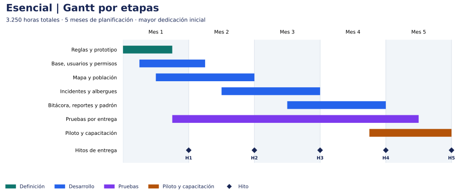
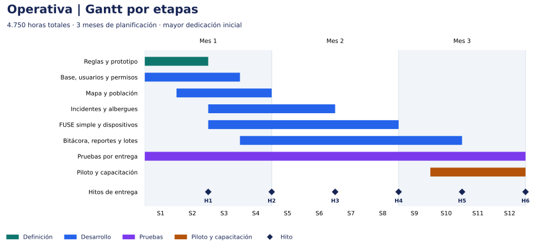
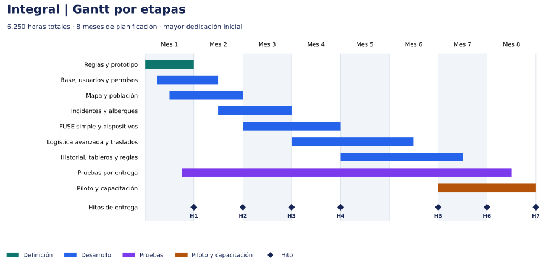

# :material-chart-gantt: Planificación de las tres propuestas

## Gantt, entregables, equipo y distribución de horas

| Campo | Detalle |
|---|---|
| Proyecto | Mesa de Situación del Fenómeno El Niño, Provincia del Chaco |
| Fecha | 15 de octubre de 2026 |
| Estado | Escenarios propuestos para revisión; dedicaciones e hitos a confirmar |
| Criterio de planificación | Concentrar equipo y esfuerzo al comienzo para adelantar entregables utilizables |
| Referencia | [Comparación funcional y estimación de las tres alternativas](mesa-situacion-el-nino.md) |

!!! abstract "Cómo leer este anexo"
    La propuesta base mantiene su estimación en horas. Este anexo distribuye esas mismas horas en escenarios de equipo y calendario. Se elige una alternativa: sus horas y sus meses no se suman con los de las otras.

## 1. Criterio de planificación

Se propone incorporar desde el comienzo a los analistas y al equipo de desarrollo de la alternativa elegida. Diseño y QA acompañan las primeras entregas; el trabajo avanza por circuitos y la dedicación se reduce a medida que se completa el alcance.

La primera versión utilizable de mapa y población se plantea al cierre del mes 2. Operativa e Integral incorporan las cuatro mesas en una versión operativa al cierre del mes 4. En Integral, los movimientos avanzados y el seguimiento completo se entregan después, según los hitos indicados.

### Supuestos del escenario

- M1 es el primer mes desde el inicio acordado. Para distribuir capacidad, cada mes representa un bloque de cuatro semanas; el calendario real se ajustará con la fecha de inicio y los días laborables.
- Se asignan hasta 140 horas de trabajo por persona y mes de planificación. La capacidad incluye las actividades de su disciplina, como revisión y correcciones en desarrollo. Es un supuesto de planificación a confirmar.
- Los totales son los escenarios centrales: 3.250, 4.750 y 6.250 horas. Cada disciplina conserva exactamente sus horas de la propuesta base.
- Los referentes validan cada entrega antes de los circuitos que dependen de ella. Las observaciones se incorporan al trabajo del período siguiente; una demora de validación requiere revisar los hitos.
- Los módulos usan los formatos y reglas acordados. Las decisiones del primer mes habilitan el desarrollo paralelo; el análisis detallado continúa por circuito.
- La mesa de ayuda funcional opcional se contrata aparte y no forma parte de estas curvas. Las ampliaciones independientes tampoco están incluidas.

La inversión se representa mediante horas asignadas. Para convertirla en importes se necesitan tarifas por perfil y condiciones de facturación. El porcentaje de horas acumuladas mide esfuerzo asignado, no porcentaje de funcionalidades aceptadas.

## 2. Comparación de escenarios

| Alternativa | Horas | Meses del escenario | Desarrolladores al inicio | Horas en M1–M2 | % del total en M1–M2 |
|---|---|---|---|---|---|
| Esencial | 3.250 | 5 | 3 | 1.575 | 48,5% |
| Operativa | 4.750 | 6 | 4 | 1.955 | 41,2% |
| Integral | 6.250 | 8 | 4 | 1.985 | 31,8% |

En Integral, los primeros cuatro meses concentran 3.800 horas, el 60,8% del total, y culminan con las cuatro mesas en su versión operativa. El resto del esfuerzo completa los circuitos avanzados, las validaciones y la capacitación.

[Abrir gráfico](assets/curva-esfuerzo.svg) · [Descargar PNG](assets/curva-esfuerzo.png)

## 3. Propuesta Esencial

**Escenario:** 3.250 horas distribuidas en 5 meses de planificación.

[Abrir Gantt](assets/gantt-esencial.svg) · [Descargar PNG](assets/gantt-esencial.png)

### Etapas y entregables

| Etapa | Ventana propuesta | Resultado |
|---|---|---|
| Reglas y prototipo | M1 | Reglas, permisos y prototipo de las pantallas principales. |
| Base, usuarios y permisos | M1–M2 | Acceso y modelo común para las funciones incluidas. |
| Mapa y población | M1–M2 | Mapa, personas, familias y relevamientos básicos. |
| Incidentes y albergues | M2–M3 | Seguimiento de incidentes, ingresos, egresos y ocupación. |
| Bitácora, reportes y padrón | M3–M4 | Pendientes, exportaciones e importación desde una plantilla. |
| Pruebas por entrega | M1–M5 | Validación funcional, permisos, concurrencia y correcciones. |
| Piloto y capacitación | M4–M5 | Uso supervisado, manuales, capacitación y conformidad final. |

La tabla indica los meses involucrados; las barras del Gantt muestran los solapamientos dentro de cada mes. Las horas de análisis y gestión continúan acompañando las entregas según la asignación mensual.

### Hitos de aceptación

| Hito | Cierre propuesto | Entregable | Cómo se verifica |
|---|---|---|---|
| H1 | M1 | Alcance y prototipo | Referentes validan campos, roles y recorrido de las pantallas principales. |
| H2 | M2 | Primera versión utilizable | Usuarios habilitados registran personas y consultan su ubicación en el mapa. |
| H3 | M3 | Atención y alojamiento | Se completa un incidente y un ingreso/egreso de albergue con ocupación consistente. |
| H4 | M4 | Alcance Esencial integrado | Bitácora, reportes y padrón funcionan junto con los módulos anteriores. |
| H5 | M5 | Conformidad de Esencial | Casos de aceptación y pruebas de carga acordadas aprobados; capacitación y manuales entregados. |

Cada hito depende de la validación de los anteriores que alimentan su circuito. Los circuitos avanzados se validan sobre una versión operativa ya integrada.

### Equipo propuesto por mes

| Perfil / personas participantes | M1 | M2 | M3 | M4 | M5 |
|---|---|---|---|---|---|
| Analistas (incluye manuales y capacitación) | 2 | 2 | 1 | 1 | 1 |
| Desarrollo | 3 | 3 | 3 | 3 | 2 |
| QA | 1 | 1 | 1 | 1 | 1 |
| UX/UI | 1 | 1 | 1 | 0 | 0 |
| Gestión | 1 | 1 | 1 | 1 | 1 |

Un desarrollador asume la conducción técnica dentro de las horas de Desarrollo. Los 3 desarrolladores iniciales cubren backend, frontend e integración. QA y diseño participan desde el arranque. Las cantidades indican personas participantes, con dedicación parcial cuando corresponda; las horas de la tabla siguiente son la asignación concreta. Manuales y capacitación se reparten entre los analistas, sin contar personal adicional.

### Horas asignadas por perfil y mes

| Disciplina | M1 | M2 | M3 | M4 | M5 | Total |
|---|---|---|---|---|---|---|
| Análisis funcional | 260 | 200 | 90 | 40 | 10 | 600 |
| Desarrollo | 420 | 420 | 420 | 380 | 260 | 1.900 |
| QA | 20 | 60 | 90 | 110 | 80 | 360 |
| UX/UI | 80 | 30 | 10 | 0 | 0 | 120 |
| Gestión | 40 | 35 | 30 | 25 | 20 | 150 |
| Manuales y capacitación | 0 | 10 | 20 | 40 | 50 | 120 |
| **Total mensual** | **820** | **755** | **660** | **595** | **420** | **3.250** |
| % del esfuerzo total | 25,2% | 23,2% | 20,3% | 18,3% | 12,9% | 100% |
| Horas acumuladas | 820 | 1.575 | 2.235 | 2.830 | 3.250 | 3.250 |

Los porcentajes se redondean a un decimal. Las horas de las tablas mensuales son las mismas del presupuesto de esfuerzo, distribuidas por período.

## 4. Propuesta Operativa

**Escenario:** 4.750 horas distribuidas en 6 meses de planificación.

[Abrir Gantt](assets/gantt-operativa.svg) · [Descargar PNG](assets/gantt-operativa.png)

### Etapas y entregables

| Etapa | Ventana propuesta | Resultado |
|---|---|---|
| Reglas y prototipo | M1 | Reglas y permisos de las cuatro mesas, incluido FUSE simple. |
| Base, usuarios y permisos | M1–M2 | Acceso, historial y separación de carga, validación y autorización. |
| Mapa y población | M1–M2 | Mapa y seguimiento de personas y necesidades. |
| Incidentes y albergues | M2–M3 | Derivaciones y gestión operativa de albergues. |
| FUSE simple y dispositivos | M3–M4 | Una entrega por solicitud, stock básico y dispositivos propios. |
| Bitácora, reportes y lotes | M4–M5 | Pases de guardia, reportes por mesa y revisión de importaciones. |
| Pruebas por entrega | M1–M6 | Validación de circuitos, permisos, concurrencia y correcciones. |
| Piloto y capacitación | M5–M6 | Validación con los equipos de las cuatro mesas y conformidad final. |

La tabla indica los meses involucrados; las barras del Gantt muestran los solapamientos dentro de cada mes. Las horas de análisis y gestión continúan acompañando las entregas según la asignación mensual.

### Hitos de aceptación

| Hito | Cierre propuesto | Entregable | Cómo se verifica |
|---|---|---|---|
| H1 | M1 | Reglas y prototipo | Se valida el alcance de las cuatro mesas y la separación de responsabilidades. |
| H2 | M2 | Primera versión utilizable | Mapa y población permiten registrar y consultar situaciones territoriales. |
| H3 | M3 | Incidentes y albergues | Un caso se deriva y sigue; la ocupación cambia a partir de ingresos y egresos. |
| H4 | M4 | Cuatro mesas operativas | Una solicitud recorre FUSE hasta la recepción, actualiza stock y se consultan dispositivos. |
| H5 | M5 | Alcance Operativa integrado | Bitácora, reportes e importaciones por lote funcionan con las cuatro mesas. |
| H6 | M6 | Conformidad de Operativa | Casos de aceptación y pruebas de carga acordadas aprobados; capacitación y manuales entregados. |

Cada hito depende de la validación de los anteriores que alimentan su circuito. Los circuitos avanzados se validan sobre una versión operativa ya integrada.

### Equipo propuesto por mes

| Perfil / personas participantes | M1 | M2 | M3 | M4 | M5 | M6 |
|---|---|---|---|---|---|---|
| Analistas (incluye manuales y capacitación) | 2 | 2 | 2 | 1 | 1 | 1 |
| Desarrollo | 4 | 4 | 4 | 4 | 4 | 3 |
| QA | 1 | 1 | 1 | 1 | 1 | 1 |
| UX/UI | 1 | 1 | 1 | 0 | 0 | 0 |
| Gestión | 1 | 1 | 1 | 1 | 1 | 1 |

Un desarrollador asume la conducción técnica dentro de las horas de Desarrollo. Los 4 desarrolladores iniciales cubren backend, frontend e integración. QA y diseño participan desde el arranque. Las cantidades indican personas participantes, con dedicación parcial cuando corresponda; las horas de la tabla siguiente son la asignación concreta. Manuales y capacitación se reparten entre los analistas, sin contar personal adicional.

### Horas asignadas por perfil y mes

| Disciplina | M1 | M2 | M3 | M4 | M5 | M6 | Total |
|---|---|---|---|---|---|---|---|
| Análisis funcional | 270 | 240 | 180 | 110 | 60 | 40 | 900 |
| Desarrollo | 560 | 560 | 520 | 480 | 430 | 300 | 2.850 |
| QA | 30 | 60 | 90 | 110 | 120 | 90 | 500 |
| UX/UI | 100 | 40 | 20 | 0 | 0 | 0 | 160 |
| Gestión | 50 | 45 | 40 | 35 | 30 | 20 | 220 |
| Manuales y capacitación | 0 | 0 | 10 | 20 | 40 | 50 | 120 |
| **Total mensual** | **1.010** | **945** | **860** | **755** | **680** | **500** | **4.750** |
| % del esfuerzo total | 21,3% | 19,9% | 18,1% | 15,9% | 14,3% | 10,5% | 100% |
| Horas acumuladas | 1.010 | 1.955 | 2.815 | 3.570 | 4.250 | 4.750 | 4.750 |

Los porcentajes se redondean a un decimal. Las horas de las tablas mensuales son las mismas del presupuesto de esfuerzo, distribuidas por período.

## 5. Propuesta Integral

**Escenario:** 6.250 horas distribuidas en 8 meses de planificación.

[Abrir Gantt](assets/gantt-integral.svg) · [Descargar PNG](assets/gantt-integral.png)

### Etapas y entregables

| Etapa | Ventana propuesta | Resultado |
|---|---|---|
| Reglas y prototipo | M1 | Reglas comunes y definición inicial de los circuitos y sus excepciones. |
| Base, usuarios y permisos | M1–M2 | Acceso, historial y estructura común para las cuatro mesas. |
| Mapa y población | M1–M2 | Primera versión de mapa y relevamientos; el análisis histórico se amplía después. |
| Incidentes y albergues | M2–M3 | Versión operativa de atención, derivaciones e ingresos/egresos. |
| FUSE simple y dispositivos | M3–M4 | Cuatro mesas vinculadas con un circuito de entrega completa. |
| Logística avanzada y traslados | M4–M6 | Reservas, parciales, devoluciones, transferencias y traslados vinculados. |
| Historial, tableros y reglas | M5–M7 | Evolución territorial, duplicados, auditoría, avisos y pases de guardia completos. |
| Pruebas por entrega | M1–M8 | Casos con excepciones, integración, concurrencia y correcciones. |
| Piloto y capacitación | M7–M8 | Validación Integral con usuarios, manuales y conformidad final. |

La tabla indica los meses involucrados; las barras del Gantt muestran los solapamientos dentro de cada mes. Las horas de análisis y gestión continúan acompañando las entregas según la asignación mensual.

### Hitos de aceptación

| Hito | Cierre propuesto | Entregable | Cómo se verifica |
|---|---|---|---|
| H1 | M1 | Reglas y prototipo | Se validan el recorrido inicial y los criterios para desarrollar los circuitos avanzados. |
| H2 | M2 | Primera versión utilizable | Mapa y población permiten registrar y consultar situaciones territoriales. |
| H3 | M3 | Incidentes y albergues | Los equipos completan los circuitos básicos de atención y alojamiento. |
| H4 | M4 | Cuatro mesas operativas | Una solicitud completa FUSE simple y los equipos consultan stock y dispositivos. |
| H5 | M6 | Movimientos avanzados | Se verifican una entrega parcial, una devolución, una transferencia y un traslado vinculado. |
| H6 | M7 | Alcance Integral integrado | Reportes históricos, auditoría, avisos y revisión de duplicados completan los circuitos. |
| H7 | M8 | Conformidad de Integral | Casos de aceptación y pruebas de carga acordadas aprobados; capacitación y manuales entregados. |

Cada hito depende de la validación de los anteriores que alimentan su circuito. Los circuitos avanzados se validan sobre una versión operativa ya integrada.

### Equipo propuesto por mes

| Perfil / personas participantes | M1 | M2 | M3 | M4 | M5 | M6 | M7 | M8 |
|---|---|---|---|---|---|---|---|---|
| Analistas (incluye manuales y capacitación) | 2 | 2 | 2 | 2 | 1 | 1 | 1 | 1 |
| Desarrollo | 4 | 4 | 4 | 4 | 4 | 4 | 3 | 2 |
| QA | 1 | 1 | 1 | 1 | 1 | 1 | 1 | 1 |
| UX/UI | 1 | 1 | 1 | 0 | 0 | 0 | 0 | 0 |
| Gestión | 1 | 1 | 1 | 1 | 1 | 1 | 1 | 1 |

Un desarrollador asume la conducción técnica dentro de las horas de Desarrollo. Los 4 desarrolladores iniciales cubren backend, frontend e integración. QA y diseño participan desde el arranque. Las cantidades indican personas participantes, con dedicación parcial cuando corresponda; las horas de la tabla siguiente son la asignación concreta. Manuales y capacitación se reparten entre los analistas, sin contar personal adicional.

### Horas asignadas por perfil y mes

| Disciplina | M1 | M2 | M3 | M4 | M5 | M6 | M7 | M8 | Total |
|---|---|---|---|---|---|---|---|---|---|
| Análisis funcional | 280 | 260 | 220 | 180 | 120 | 80 | 40 | 20 | 1.200 |
| Desarrollo | 560 | 560 | 560 | 560 | 500 | 440 | 380 | 280 | 3.840 |
| QA | 30 | 50 | 80 | 100 | 110 | 110 | 100 | 60 | 640 |
| UX/UI | 100 | 60 | 40 | 0 | 0 | 0 | 0 | 0 | 200 |
| Gestión | 45 | 40 | 35 | 30 | 25 | 25 | 20 | 20 | 240 |
| Manuales y capacitación | 0 | 0 | 0 | 10 | 20 | 25 | 35 | 40 | 130 |
| **Total mensual** | **1.015** | **970** | **935** | **880** | **775** | **680** | **575** | **420** | **6.250** |
| % del esfuerzo total | 16,2% | 15,5% | 15,0% | 14,1% | 12,4% | 10,9% | 9,2% | 6,7% | 100% |
| Horas acumuladas | 1.015 | 1.985 | 2.920 | 3.800 | 4.575 | 5.255 | 5.830 | 6.250 | 6.250 |

Los porcentajes se redondean a un decimal. Las horas de las tablas mensuales son las mismas del presupuesto de esfuerzo, distribuidas por período.

## 6. Qué se entrega y qué habilita el avance

Cada entrega incluye una demostración con datos de prueba, casos verificables y registro de observaciones. Una versión utilizable permite probar el circuito incluido con usuarios habilitados; la conformidad final exige los casos de aceptación y las pruebas de concurrencia acordadas para la alternativa.

La capacitación acompaña las entregas y se refuerza en el cierre. Los hitos funcionales orientan el seguimiento y la aceptación; cualquier esquema de facturación por hito se acuerda por separado.

La planificación deberá ajustarse si cambia el alcance, la dedicación real o la disponibilidad de los referentes. El esfuerzo total seguirá expresándose en horas y cada revisión identificará qué entregables y asignaciones cambian.

## 7. Datos de planificación

Las tablas y los gráficos se generan con una única distribución de horas por perfil. Puede descargarse el [archivo de datos](assets/planificacion-mesa-horas.json) para revisar las asignaciones. Las sumas por disciplina coinciden con la [propuesta funcional](mesa-situacion-el-nino.md#6-horas-de-trabajo-por-alternativa).
