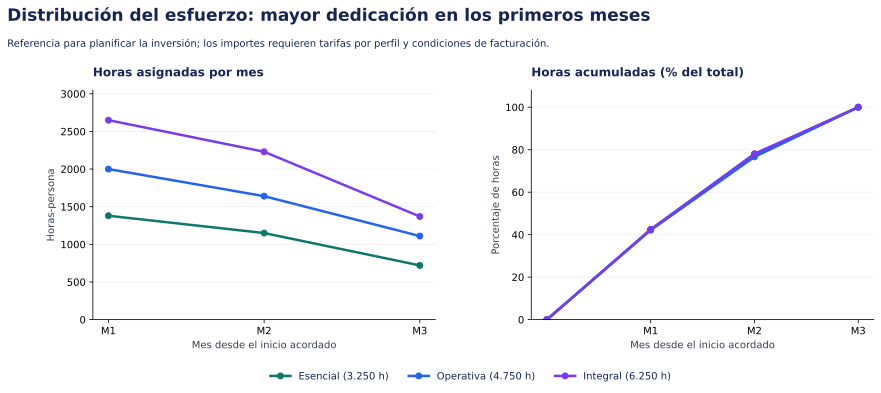
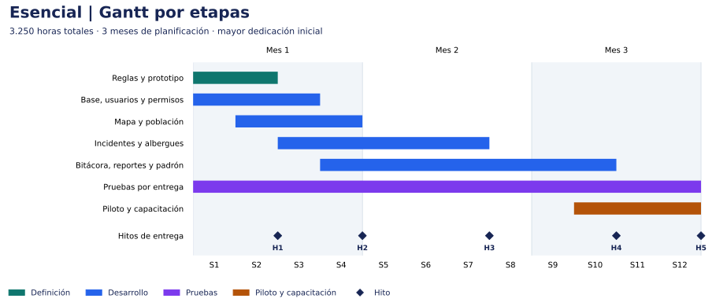
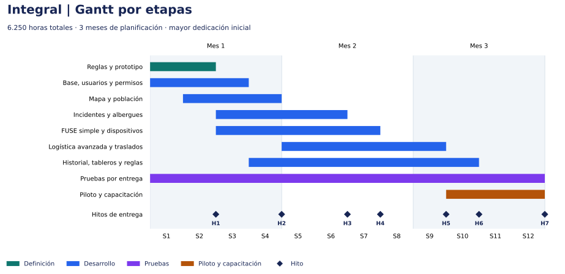

# :material-chart-gantt: Planificación de las tres propuestas

## Gantt, entregables, equipo y distribución de horas

| Campo | Detalle |
|---|---|
| Proyecto | Mesa de Situación del Fenómeno El Niño, Provincia del Chaco |
| Fecha | 16 de octubre de 2026 |
| Estado | Escenarios propuestos para revisión; dedicaciones e hitos a confirmar |
| Ventana acordada para planificar | Máximo tres meses desde el inicio acordado |
| Criterio de planificación | Concentrar equipo y esfuerzo al comienzo para adelantar entregables utilizables |
| Referencia | [Comparación funcional y estimación de las tres alternativas](mesa-situacion-el-nino.md) |

!!! abstract "Cómo leer este anexo"
    La propuesta base mantiene su estimación en horas. Este anexo distribuye esas mismas horas en escenarios de equipo y calendario. Se elige una alternativa: sus horas y sus meses no se suman con los de las otras.

## 1. Criterio de planificación

Se propone incorporar desde el comienzo a los analistas y al equipo de desarrollo de la alternativa elegida. Diseño y QA acompañan las primeras entregas; el trabajo avanza por circuitos y la dedicación se reduce a medida que se completa el alcance.

Las tres alternativas se organizan para completar su alcance dentro de tres meses desde el inicio acordado. La primera versión utilizable de mapa y población se plantea al cierre del primer mes. Operativa e Integral incorporan las cuatro mesas durante el segundo mes. El tercero completa las funciones restantes, el piloto y la aceptación.

Para sostener esa ventana se propone un equipo inicial más amplio, con varios circuitos en desarrollo simultáneo. Las horas totales y el alcance de cada alternativa se conservan. El dimensionamiento expresa capacidad prevista; el plazo requiere validar las dependencias y disponer del equipo desde el inicio.

### Supuestos del escenario

- M1, M2 y M3 son bloques de cuatro semanas: el Gantt comprende doce semanas dentro de una ventana máxima de tres meses. La fecha de cierre se calculará desde el inicio acordado; feriados y disponibilidad se contemplarán al fijar el calendario.
- Se asignan hasta 140 horas de trabajo por persona y mes de planificación. La capacidad incluye las actividades de su disciplina, como revisión y correcciones en desarrollo. Es un supuesto de planificación a confirmar.
- Los totales son los escenarios centrales: 3.250, 4.750 y 6.250 horas. Cada disciplina conserva exactamente sus horas de la propuesta base.
- El equipo completo se encuentra disponible al inicio. El escenario no incluye un período previo de contratación o incorporación dentro de las doce semanas.
- Se propone que los referentes respondan las validaciones en hasta dos días hábiles. Esta disponibilidad debe acordarse para sostener los hitos.
- Durante las primeras dos semanas se acuerdan campos, permisos, formatos de intercambio y reglas comunes. El análisis detallado continúa por circuito y acompaña a los equipos que desarrollan en paralelo.
- La primera semana permite revisar dependencias y reparto de módulos. La conducción técnica, la integración y las correcciones consumen horas del presupuesto existente. Si esa revisión exige trabajo adicional, se revisará la estimación antes de comprometer el cronograma.
- La mesa de ayuda funcional opcional se contrata aparte y no forma parte de estas curvas. Las ampliaciones independientes tampoco están incluidas.

La inversión se representa mediante horas asignadas. Para convertirla en importes se necesitan tarifas por perfil y condiciones de facturación. El porcentaje de horas acumuladas mide esfuerzo asignado, no porcentaje de funcionalidades aceptadas.

## 2. Comparación de escenarios

| Alternativa | Horas | Meses del escenario | Desarrolladores al inicio | Horas en M1–M2 | % del total en M1–M2 |
|---|---|---|---|---|---|
| Esencial | 3.250 | 3 | 6 | 2.530 | 77,8% |
| Operativa | 4.750 | 3 | 9 | 3.640 | 76,6% |
| Integral | 6.250 | 3 | 12 | 4.880 | 78,1% |

En Integral, los primeros dos meses concentran 4.880 horas, el 78,1% del total. El tercer mes reúne 1.370 horas para completar los circuitos avanzados, validar el conjunto y capacitar a los equipos.

La mayor dotación inicial permite trabajar por frentes. Esencial distribuye el desarrollo entre mapa y población, atención y albergues, y funciones comunes. Operativa incorpora un frente de FUSE y dispositivos. Integral separa además logística avanzada y seguimiento. Un responsable técnico coordina contratos de datos, revisiones e integración dentro de las horas de Desarrollo.

[Abrir gráfico](assets/curva-esfuerzo-df6cee400d8e.svg) · [Descargar PNG](assets/curva-esfuerzo-a4fe3ae61814.png)

## 3. Propuesta Esencial

**Escenario:** 3.250 horas distribuidas en 3 meses de planificación.

[Abrir Gantt](assets/gantt-esencial-8cba9319c7bc.svg) · [Descargar PNG](assets/gantt-esencial-ebb4b21f4444.png)

### Etapas y entregables

| Etapa | Ventana propuesta | Resultado |
|---|---|---|
| Reglas y prototipo | M1 | Reglas, permisos y prototipo de las pantallas principales. |
| Base, usuarios y permisos | M1 | Acceso y modelo común para las funciones incluidas. |
| Mapa y población | M1 | Mapa, personas, familias y relevamientos básicos. |
| Incidentes y albergues | M1–M2 | Seguimiento de incidentes, ingresos, egresos y ocupación. |
| Bitácora, reportes y padrón | M1–M3 | Pendientes, exportaciones e importación desde una plantilla. |
| Pruebas por entrega | M1–M3 | Validación funcional, permisos, concurrencia y correcciones. |
| Piloto y capacitación | M3 | Uso supervisado, manuales, capacitación y conformidad final. |

La tabla indica los meses involucrados; las barras del Gantt muestran los solapamientos dentro de cada mes. Las horas de análisis y gestión continúan acompañando las entregas según la asignación mensual.

### Hitos de aceptación

| Hito | Cierre propuesto | Entregable | Cómo se verifica |
|---|---|---|---|
| H1 | Semana 2 | Alcance y prototipo | Referentes validan campos, roles y recorrido de las pantallas principales. |
| H2 | Semana 4 | Primera versión utilizable | Usuarios habilitados registran personas y consultan su ubicación en el mapa. |
| H3 | Semana 7 | Atención y alojamiento | Se completa un incidente y un ingreso/egreso de albergue con ocupación consistente. |
| H4 | Semana 10 | Alcance Esencial integrado | Bitácora, reportes y padrón funcionan junto con los módulos anteriores. |
| H5 | Semana 12 | Conformidad de Esencial | Casos de aceptación y pruebas de carga acordadas aprobados; capacitación y manuales entregados. |

Cada hito depende de la validación de los anteriores que alimentan su circuito. Los frentes pueden construir en paralelo con contratos de datos acordados; la aceptación de las funciones avanzadas exige integrar primero sus circuitos base.

### Equipo propuesto por mes

| Perfil / personas participantes | M1 | M2 | M3 |
|---|---|---|---|
| Analistas (incluye manuales y capacitación) | 3 | 2 | 2 |
| Desarrollo | 6 | 5 | 3 |
| QA | 1 | 1 | 1 |
| UX/UI | 1 | 1 | 0 |
| Gestión | 1 | 1 | 1 |

Participación máxima en un mismo mes: **12 personas**, con dedicaciones según las horas siguientes. Incluye todos los perfiles del cuadro; una persona no se cuenta en dos roles.

Un desarrollador asume la conducción técnica dentro de las horas de Desarrollo. Los 6 desarrolladores iniciales cubren backend, frontend e integración. QA y diseño participan desde el arranque. Las cantidades indican personas participantes, con dedicación parcial cuando corresponda; las horas de la tabla siguiente son la asignación concreta. Manuales y capacitación se reparten entre los analistas, sin contar personal adicional.

### Horas asignadas por perfil y mes

| Disciplina | M1 | M2 | M3 | Total |
|---|---|---|---|---|
| Análisis funcional | 300 | 200 | 100 | 600 |
| Desarrollo | 840 | 700 | 360 | 1.900 |
| QA | 80 | 140 | 140 | 360 |
| UX/UI | 90 | 30 | 0 | 120 |
| Gestión | 60 | 50 | 40 | 150 |
| Manuales y capacitación | 10 | 30 | 80 | 120 |
| **Total mensual** | **1.380** | **1.150** | **720** | **3.250** |
| % del esfuerzo total | 42,5% | 35,4% | 22,2% | 100% |
| Horas acumuladas | 1.380 | 2.530 | 3.250 | 3.250 |

Los porcentajes se redondean a un decimal. Las horas de las tablas mensuales son las mismas del presupuesto de esfuerzo, distribuidas por período.

## 4. Propuesta Operativa

**Escenario:** 4.750 horas distribuidas en 3 meses de planificación.

[Abrir Gantt](assets/gantt-operativa-6bfedd850280.svg) · [Descargar PNG](assets/gantt-operativa-b44f4be13d80.png)

### Etapas y entregables

| Etapa | Ventana propuesta | Resultado |
|---|---|---|
| Reglas y prototipo | M1 | Reglas y permisos de las cuatro mesas, incluido FUSE simple. |
| Base, usuarios y permisos | M1 | Acceso, historial y separación de carga, validación y autorización. |
| Mapa y población | M1 | Mapa y seguimiento de personas y necesidades. |
| Incidentes y albergues | M1–M2 | Derivaciones y gestión operativa de albergues. |
| FUSE simple y dispositivos | M1–M2 | Una entrega por solicitud, stock básico y dispositivos propios. |
| Bitácora, reportes y lotes | M1–M3 | Pases de guardia, reportes por mesa y revisión de importaciones. |
| Pruebas por entrega | M1–M3 | Validación de circuitos, permisos, concurrencia y correcciones. |
| Piloto y capacitación | M3 | Validación con los equipos de las cuatro mesas y conformidad final. |

La tabla indica los meses involucrados; las barras del Gantt muestran los solapamientos dentro de cada mes. Las horas de análisis y gestión continúan acompañando las entregas según la asignación mensual.

### Hitos de aceptación

| Hito | Cierre propuesto | Entregable | Cómo se verifica |
|---|---|---|---|
| H1 | Semana 2 | Reglas y prototipo | Se valida el alcance de las cuatro mesas y la separación de responsabilidades. |
| H2 | Semana 4 | Primera versión utilizable | Mapa y población permiten registrar y consultar situaciones territoriales. |
| H3 | Semana 6 | Incidentes y albergues | Un caso se deriva y sigue; la ocupación cambia a partir de ingresos y egresos. |
| H4 | Semana 8 | Cuatro mesas operativas | Una solicitud recorre FUSE hasta la recepción, actualiza stock y se consultan dispositivos. |
| H5 | Semana 10 | Alcance Operativa integrado | Bitácora, reportes e importaciones por lote funcionan con las cuatro mesas. |
| H6 | Semana 12 | Conformidad de Operativa | Casos de aceptación y pruebas de carga acordadas aprobados; capacitación y manuales entregados. |

Cada hito depende de la validación de los anteriores que alimentan su circuito. Los frentes pueden construir en paralelo con contratos de datos acordados; la aceptación de las funciones avanzadas exige integrar primero sus circuitos base.

### Equipo propuesto por mes

| Perfil / personas participantes | M1 | M2 | M3 |
|---|---|---|---|
| Analistas (incluye manuales y capacitación) | 4 | 3 | 2 |
| Desarrollo | 9 | 7 | 5 |
| QA | 1 | 2 | 2 |
| UX/UI | 1 | 1 | 0 |
| Gestión | 1 | 1 | 1 |

Participación máxima en un mismo mes: **16 personas**, con dedicaciones según las horas siguientes. Incluye todos los perfiles del cuadro; una persona no se cuenta en dos roles.

Un desarrollador asume la conducción técnica dentro de las horas de Desarrollo. Los 9 desarrolladores iniciales cubren backend, frontend e integración. QA y diseño participan desde el arranque. Las cantidades indican personas participantes, con dedicación parcial cuando corresponda; las horas de la tabla siguiente son la asignación concreta. Manuales y capacitación se reparten entre los analistas, sin contar personal adicional.

### Horas asignadas por perfil y mes

| Disciplina | M1 | M2 | M3 | Total |
|---|---|---|---|---|
| Análisis funcional | 420 | 300 | 180 | 900 |
| Desarrollo | 1.260 | 980 | 610 | 2.850 |
| QA | 120 | 200 | 180 | 500 |
| UX/UI | 100 | 60 | 0 | 160 |
| Gestión | 90 | 70 | 60 | 220 |
| Manuales y capacitación | 10 | 30 | 80 | 120 |
| **Total mensual** | **2.000** | **1.640** | **1.110** | **4.750** |
| % del esfuerzo total | 42,1% | 34,5% | 23,4% | 100% |
| Horas acumuladas | 2.000 | 3.640 | 4.750 | 4.750 |

Los porcentajes se redondean a un decimal. Las horas de las tablas mensuales son las mismas del presupuesto de esfuerzo, distribuidas por período.

## 5. Propuesta Integral

**Escenario:** 6.250 horas distribuidas en 3 meses de planificación.

[Abrir Gantt](assets/gantt-integral-c03379fdb70c.svg) · [Descargar PNG](assets/gantt-integral-91724a22641c.png)

### Etapas y entregables

| Etapa | Ventana propuesta | Resultado |
|---|---|---|
| Reglas y prototipo | M1 | Reglas comunes y definición inicial de los circuitos y sus excepciones. |
| Base, usuarios y permisos | M1 | Acceso, historial y estructura común para las cuatro mesas. |
| Mapa y población | M1 | Primera versión de mapa y relevamientos; el análisis histórico se amplía después. |
| Incidentes y albergues | M1–M2 | Versión operativa de atención, derivaciones e ingresos/egresos. |
| FUSE simple y dispositivos | M1–M2 | Cuatro mesas vinculadas con un circuito de entrega completa. |
| Logística avanzada y traslados | M2–M3 | Reservas, parciales, devoluciones, transferencias y traslados vinculados. |
| Historial, tableros y reglas | M1–M3 | Evolución territorial, duplicados, auditoría, avisos y pases de guardia completos. |
| Pruebas por entrega | M1–M3 | Casos con excepciones, integración, concurrencia y correcciones. |
| Piloto y capacitación | M3 | Validación Integral con usuarios, manuales y conformidad final. |

La tabla indica los meses involucrados; las barras del Gantt muestran los solapamientos dentro de cada mes. Las horas de análisis y gestión continúan acompañando las entregas según la asignación mensual.

### Hitos de aceptación

| Hito | Cierre propuesto | Entregable | Cómo se verifica |
|---|---|---|---|
| H1 | Semana 2 | Reglas y prototipo | Se validan el recorrido inicial y los criterios para desarrollar los circuitos avanzados. |
| H2 | Semana 4 | Primera versión utilizable | Mapa y población permiten registrar y consultar situaciones territoriales. |
| H3 | Semana 6 | Incidentes y albergues | Los equipos completan los circuitos básicos de atención y alojamiento. |
| H4 | Semana 7 | Cuatro mesas operativas | Una solicitud completa FUSE simple y los equipos consultan stock y dispositivos. |
| H5 | Semana 9 | Movimientos avanzados | Se verifican una entrega parcial, una devolución, una transferencia y un traslado vinculado. |
| H6 | Semana 10 | Alcance Integral integrado | Reportes históricos, auditoría, avisos y revisión de duplicados completan los circuitos. |
| H7 | Semana 12 | Conformidad de Integral | Casos de aceptación y pruebas de carga acordadas aprobados; capacitación y manuales entregados. |

Cada hito depende de la validación de los anteriores que alimentan su circuito. Los frentes pueden construir en paralelo con contratos de datos acordados; la aceptación de las funciones avanzadas exige integrar primero sus circuitos base.

### Equipo propuesto por mes

| Perfil / personas participantes | M1 | M2 | M3 |
|---|---|---|---|
| Analistas (incluye manuales y capacitación) | 5 | 4 | 3 |
| Desarrollo | 12 | 10 | 6 |
| QA | 2 | 2 | 2 |
| UX/UI | 1 | 1 | 0 |
| Gestión | 1 | 1 | 1 |

Participación máxima en un mismo mes: **21 personas**, con dedicaciones según las horas siguientes. Incluye todos los perfiles del cuadro; una persona no se cuenta en dos roles.

Un desarrollador asume la conducción técnica dentro de las horas de Desarrollo. Los 12 desarrolladores iniciales cubren backend, frontend e integración. QA y diseño participan desde el arranque. Las cantidades indican personas participantes, con dedicación parcial cuando corresponda; las horas de la tabla siguiente son la asignación concreta. Manuales y capacitación se reparten entre los analistas, sin contar personal adicional.

### Horas asignadas por perfil y mes

| Disciplina | M1 | M2 | M3 | Total |
|---|---|---|---|---|
| Análisis funcional | 560 | 420 | 220 | 1.200 |
| Desarrollo | 1.680 | 1.400 | 760 | 3.840 |
| QA | 160 | 240 | 240 | 640 |
| UX/UI | 140 | 60 | 0 | 200 |
| Gestión | 100 | 80 | 60 | 240 |
| Manuales y capacitación | 10 | 30 | 90 | 130 |
| **Total mensual** | **2.650** | **2.230** | **1.370** | **6.250** |
| % del esfuerzo total | 42,4% | 35,7% | 21,9% | 100% |
| Horas acumuladas | 2.650 | 4.880 | 6.250 | 6.250 |

Los porcentajes se redondean a un decimal. Las horas de las tablas mensuales son las mismas del presupuesto de esfuerzo, distribuidas por período.

## 6. Qué se entrega y qué habilita el avance

Cada entrega incluye una demostración con datos de prueba, casos verificables y registro de observaciones. Una versión utilizable permite probar el circuito incluido con usuarios habilitados; la conformidad final exige los casos de aceptación y las pruebas de concurrencia acordadas para la alternativa.

La capacitación acompaña las entregas y se refuerza en el cierre. Los hitos funcionales orientan el seguimiento y la aceptación; cualquier esquema de facturación por hito se acuerda por separado.

La planificación deberá ajustarse si cambia el alcance, la dedicación real o la disponibilidad de los referentes. El esfuerzo total seguirá expresándose en horas y cada revisión identificará qué entregables y asignaciones cambian.

## 7. Datos de planificación

Las tablas y los gráficos se generan con una única distribución de horas por perfil. Puede descargarse el [archivo de datos](assets/planificacion-mesa-horas.json) para revisar las asignaciones. Las sumas por disciplina coinciden con la [propuesta funcional](mesa-situacion-el-nino.md#6-horas-de-trabajo-por-alternativa).
